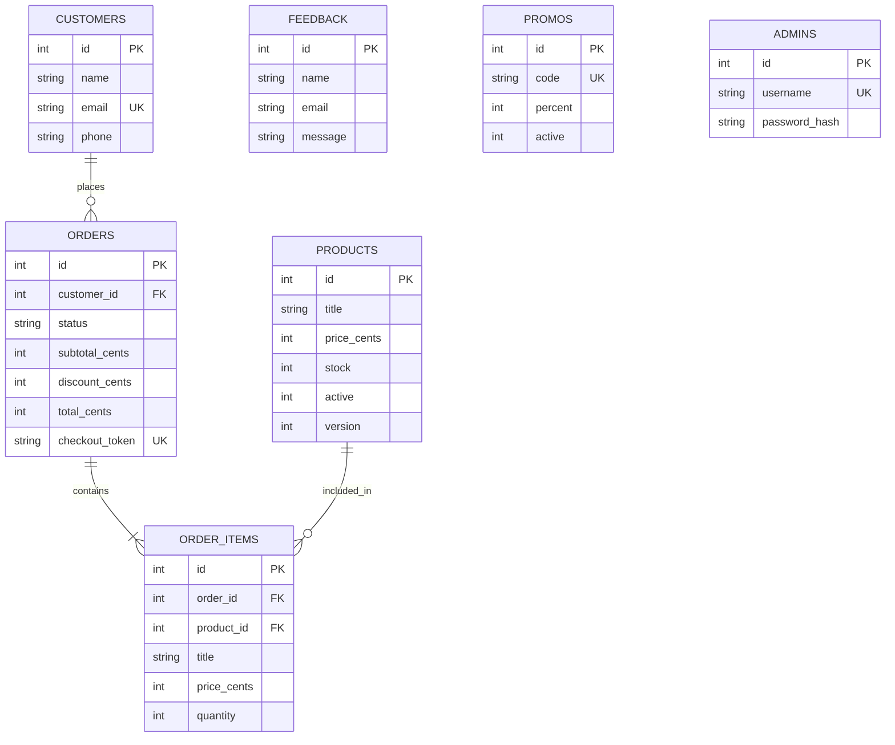
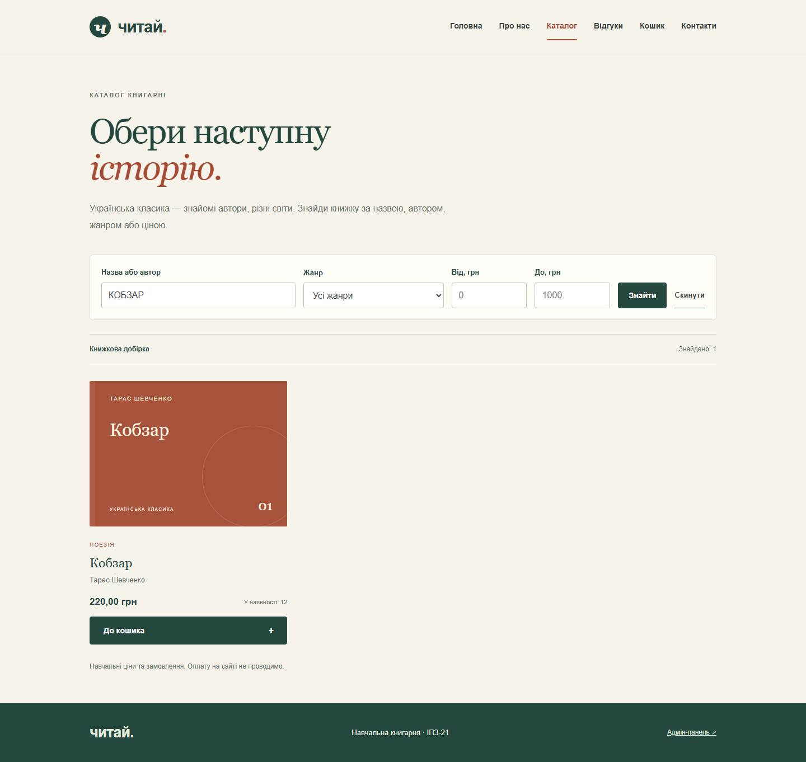
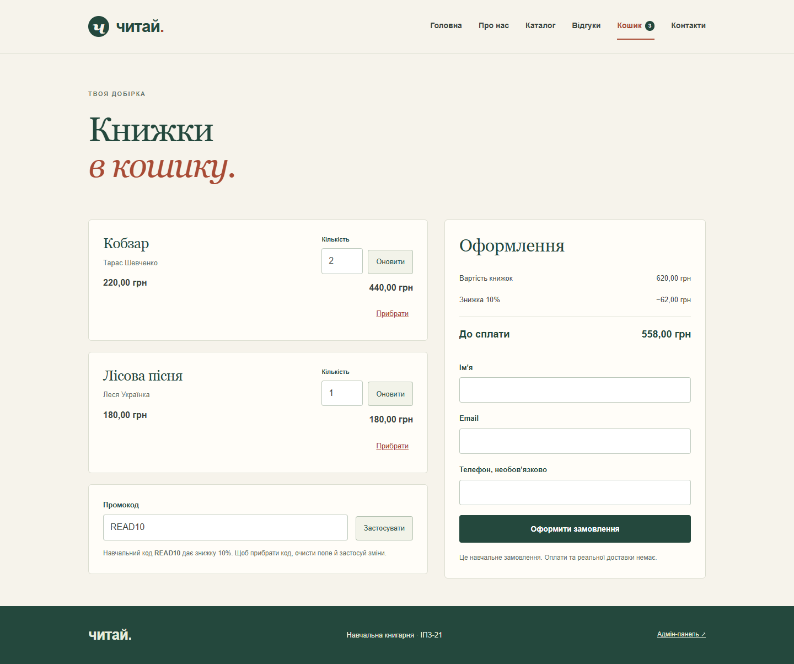
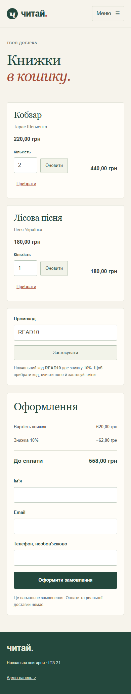
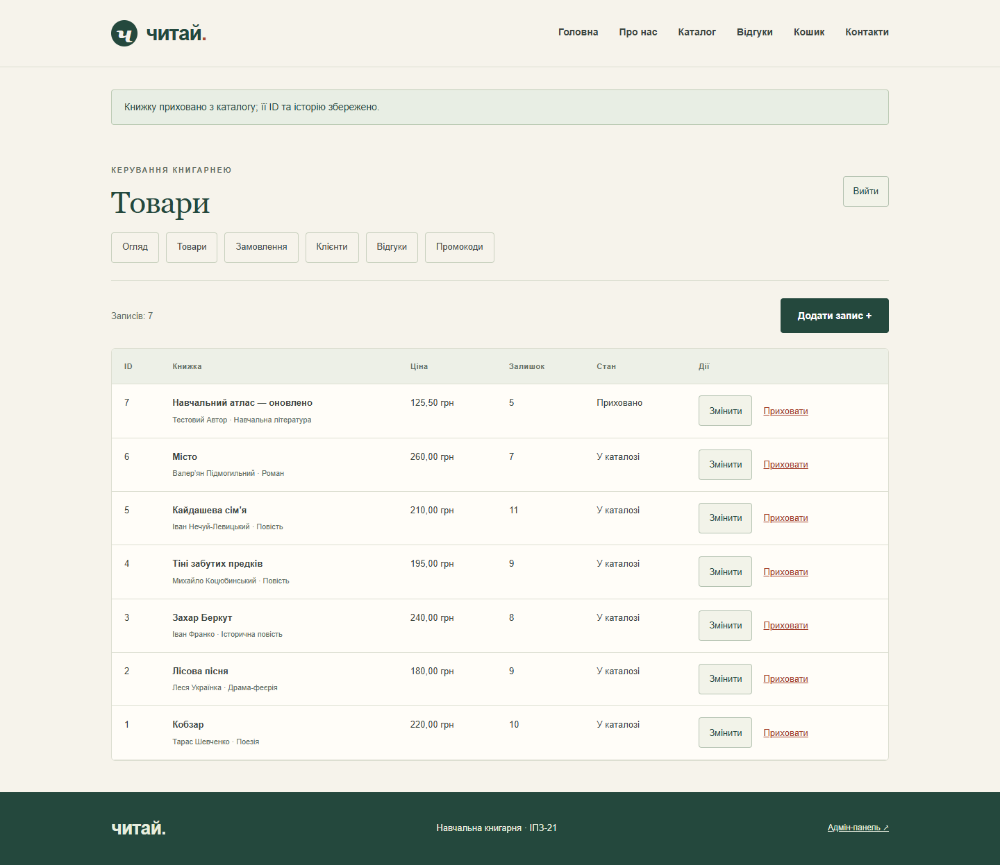
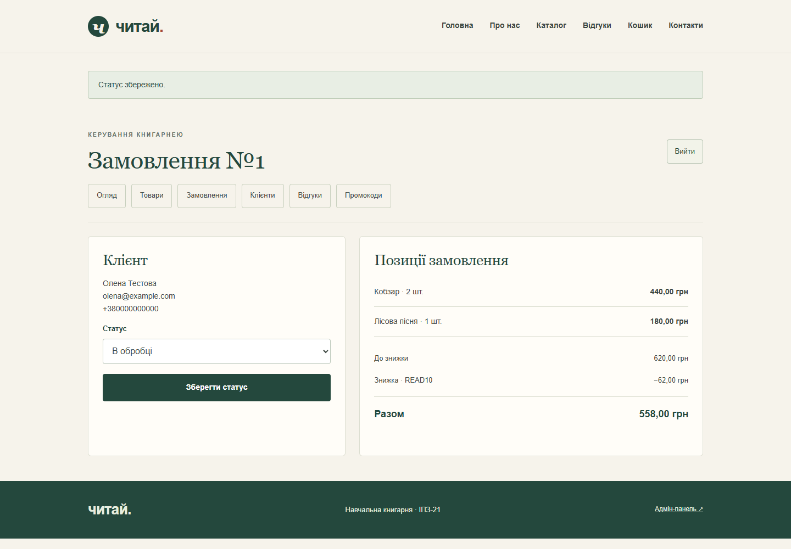
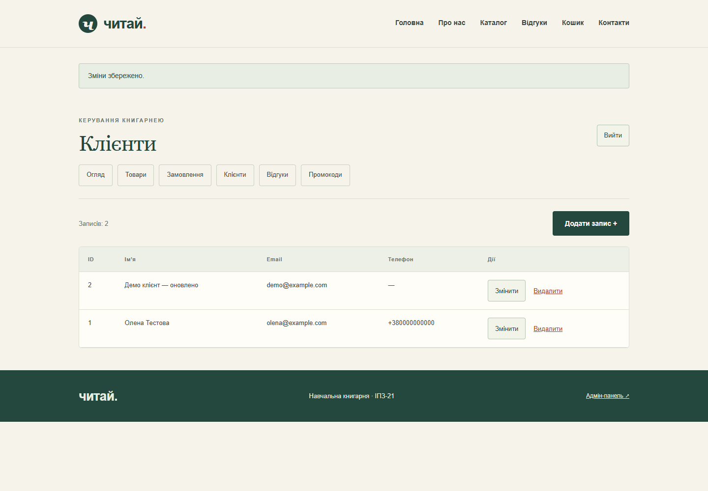
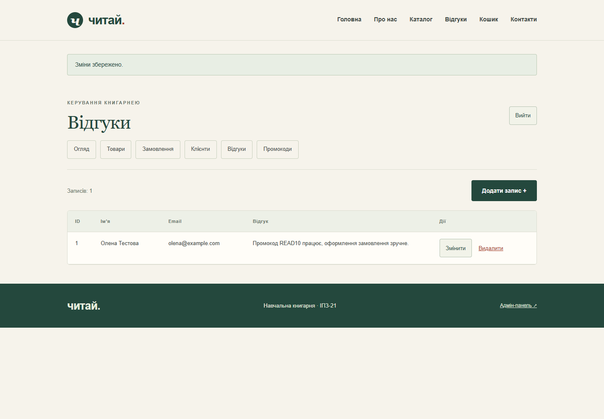
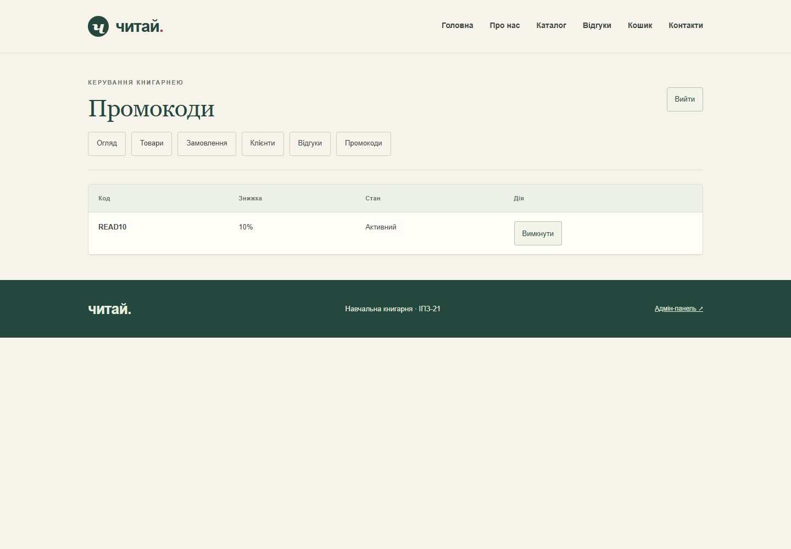
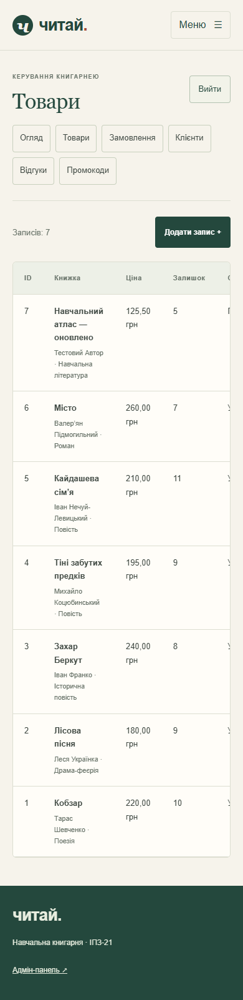

# Лабораторна робота №4

**Тема:** Реалізація бази даних для вебпроєкту.

**Виконав:** Цвіркунов Олексій Дмитрович.

**Група:** ІПЗ-21.

**Предметна область:** навчальна книгарня української літератури «Читай».

**Реалізовані технічні завдання:** рівні 1–3.

**Репозиторій:** https://github.com/73ts23-prog/opi-lab04-sqlite-bookshop

## Мета

Навчитися створювати SQLite-базу, пов’язувати таблиці та виконувати CRUD-операції у Flask-застосунку.

## Склад команди й особистий внесок

Роботу виконано індивідуально як продовження ЛР03. Реалізовано схему, моделі, маршрути, адмін-панель, кошик, промокоди, перевірки та звіт. Методичка передбачає команду з 3–4 осіб; внески інших учасників не заявляються, погодження індивідуального формату з викладачем не підтверджено.

- [c7d237a](https://github.com/73ts23-prog/opi-lab04-sqlite-bookshop/commit/c7d237a) — база, CRUD, замовлення та захищена адмін-панель.
- [117e36a](https://github.com/73ts23-prog/opi-lab04-sqlite-bookshop/commit/117e36a) — стабільні ID товарів і захист від застарілих форм залишку.
- [84ed5e3](https://github.com/73ts23-prog/opi-lab04-sqlite-bookshop/commit/84ed5e3) — коректні підписи заповнених полів форм.

## Реалізація

Використано Python, Flask, SQLite та Flask-WTF. База створюється в `instance/db.sqlite`; схема зберігається у [schema.sql](../schema.sql), запити — у [models.py](../models.py). Пароль адміністратора задається під час створення облікового запису й зберігається як хеш.

| Вимога | Результат |
|---|---|
| CRUD відгуків | Створення через форму, перегляд, редагування та видалення в адмін-панелі |
| Товари й замовлення | Каталог, кошик, оформлення та позиції замовлення |
| Зв’язки та статуси | FK, таблиця `order_items`, дозволені переходи статусів |
| Додаткова таблиця | Клієнти: створення, перегляд, редагування та видалення без пов’язаних замовлень |
| Додаткова функція 1 | Пошук за назвою й автором, фільтри жанру та ціни |
| Додаткова функція 2 | Промокод `READ10` на 10%, його ввімкнення й вимкнення адміністратором |

Товари прибираються з каталогу логічно (`active=0`): це зберігає ID у старих кошиках та історію. Відгуки й клієнти без замовлень видаляються фізично. Застаріле редагування товару перевіряється за полем `version`.

## Схема бази даних

Клієнт має багато замовлень. Зв’язок замовлень і товарів «багато-до-багатьох» реалізовано через `order_items`. Кожна позиція зберігає кількість та знімок назви й ціни. Комбінація `order_id, product_id` унікальна.

Знижка та код записуються в замовлення як знімок, тому зміна стану промокоду не переписує старі суми. Усі гроші зберігаються цілими числами в копійках. `PRAGMA foreign_keys=ON` виконується після кожного підключення; з’єднання закривається після запиту.

## Скріншоти роботи

Рисунок 1 — пошук «КОБЗАР». Знайдено потрібну книжку незалежно від регістру українських літер.

Рисунок 2 — дві книжки «Кобзар» і одна «Лісова пісня» коштують 620 грн. Промокод зменшує суму на 62 грн, разом — 558 грн.

Рисунок 3 — кошик при ширині 390 px. Позиції та форма розміщені послідовно, горизонтального прокручування сторінки немає.

Рисунок 4 — товари в адмін-панелі. Тестову книжку створено, відредаговано та приховано; після замовлення залишки двох основних книжок зменшилися.

Рисунок 5 — замовлення з двома позиціями та знижкою. Статус змінено з «Нове» на «В обробці».

Рисунок 6 — клієнт із замовлення та окремий тестовий клієнт після редагування. Після скріншота тестового клієнта без замовлень видалено.

Рисунок 7 — відгук після редагування адміністратором. У таблиці доступні перегляд, зміна та видалення.

Рисунок 8 — активний код `READ10`. Перевірено вимкнення та повторне ввімкнення.

Рисунок 9 — адмін-панель на вузькому екрані. Широка таблиця прокручується у власній області.

Дані покупців на скріншотах вигадані. Реальної оплати та доставки немає.

## Перевірка й труднощі

Пройшли 35 автоматичних перевірок з окремими тимчасовими БД. Перевірено CRUD, FK, CSRF, захист адмін-панелі, відкат замовлення при нестачі товару, збереження після перезапуску, знижки, повторний checkout та застарілі форми.

У браузері пройдено 11 етапів від пошуку до зміни статусу; додатково перевірено 55 поєднань сторінки й ширини екрана (375–1440 px). Помилок JavaScript і горизонтального переповнення сторінки не виявлено. Після сценарію в БД перевірено одне замовлення, дві позиції, суму 55800 копійок та правильні залишки; `integrity_check` і `foreign_key_check` — без помилок.

Основна складність — узгодженість залишків. Для цього оформлення виконується однією транзакцією, повторний запит має унікальний токен, а застаріла адмін-форма відхиляється за версією запису. Підписи списків і текстових полів винесено в окремі `label`, щоб вони не включали значення поля.

## Контрольні запитання

**1. Що таке база даних і СКБД? Чим вони відрізняються?**

База даних — це організовані дані, а СКБД — засіб для їх збереження та обробки. У роботі файл `db.sqlite` є базою, а SQLite — СКБД.

**2. Що таке реляційна модель даних? Поясніть поняття таблиці, рядка та стовпця.**

Дані подаються як пов’язані таблиці. Рядок — окремий запис, наприклад книжка, а стовпець — її властивість, наприклад назва або ціна.

**3. Що таке первинний і зовнішній ключі? Наведіть приклади з вашого проєкту.**

Первинний ключ однозначно визначає запис: наприклад, `products.id`. Зовнішній ключ посилається на іншу таблицю: `orders.customer_id` посилається на `customers.id`.

**4. Які типи зв’язків між таблицями існують? Як реалізувати зв’язок «багато-до-багатьох» між замовленнями й товарами?**

Є зв’язки один-до-одного, один-до-багатьох та багато-до-багатьох. Для останнього потрібна проміжна таблиця `order_items` із ключами замовлення й товару.

**5. Що означає абревіатура CRUD і яким SQL-командам відповідає кожна операція?**

Create — `INSERT`, Read — `SELECT`, Update — `UPDATE`, Delete — `DELETE`. Для товарів використано логічне прибирання з каталогу через `UPDATE active=0`.

**6. Які переваги та обмеження має SQLite порівняно з клієнт-серверними СКБД?**

SQLite не потребує окремого сервера та зберігає дані у файлі. Вона зручна для невеликого навчального проєкту, але гірше підходить для великої кількості одночасних записів.

**7. Що таке SQL-ін’єкція і як параметризовані запити захищають від неї?**

SQL-ін’єкція — спроба передати команду через введені дані. Плейсхолдери `?` передають значення окремо від SQL-коду, тому введений текст не стає командою.

**8. Навіщо відкривати й закривати з’єднання з базою даних для кожного запиту та викликати `commit()`?**

Це звільняє ресурси після обробки запиту. `commit()` зберігає зміни; при помилці транзакція відкочується. Контекст `with db` сам не закриває з’єднання, тому використано teardown.

## Висновок

У Flask-проєкті реалізовано SQLite-базу, CRUD, кошик, замовлення й адмін-панель. Перевірено зв’язки таблиць, залишки, статуси та додаткові функції пошуку й промокодів.

## Джерело

[Методичка лабораторної №4](https://github.com/olroi421/course-opi-v2/blob/main/labs/lab-04.md).
